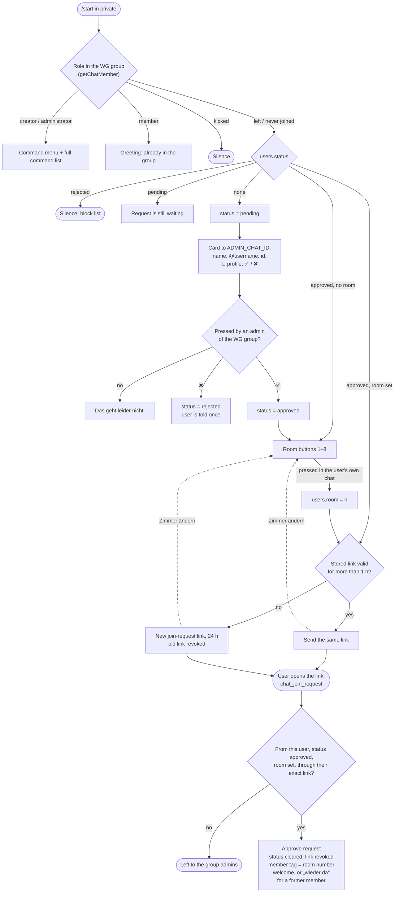

# Kehrwoche


A Telegram bot that reminds a shared flat (WG) group chat who's on cleaning duty this week.

Runs as serverless Go functions on Vercel, with the rotation schedule stored in a Postgres database (Neon).

## Setup

```bash
cp .env.example .env   # fill in the values
```

| Variable | Description |
|---|---|
| `TELEGRAM_BOT_TOKEN` | bot token from @BotFather |
| `CHAT_ID` | group chat the weekly reminder is sent to |
| `DATABASE_URL` | Postgres connection string (use Neon's pooler endpoint) |
| `WEBHOOK_SECRET` | secret Telegram must send with every webhook call |
| `CRON_SECRET` | bearer token Vercel Cron must send |
| `ADMIN_CHAT_ID` | your private chat with the bot (= your Telegram id) or a small group with the bot in it: failure notices and onboarding approvals. Only admins of the WG group can approve or reject |
| `ONBOARDING_ENABLED` | `true` turns the onboarding on; unset or anything else leaves it off, and strangers' `/start` gets a plain greeting |

Set the same variables in the Vercel project dashboard for deployment.

## Development

Install [Task](https://taskfile.dev):

```bash
brew install go-task/tap/go-task   # macOS
```

```bash
task test              # unit tests (no database)
task test:integration  # integration tests against a throwaway Postgres (needs Docker)
task build             # compile all packages
task vet               # go vet
task lint              # golangci-lint
task fmt               # gofmt
task tidy              # tidy dependencies
task migrate           # apply database migrations
task seed -- -dry      # seed / regenerate the schedule (flags after --)
task setcommands       # command menu for the group, /start in private (manual)
task setwebhook        # re-register the webhook with the update kinds the bot handles (manual)
task mcp               # run the MCP server (started by an MCP client, not by hand)
```

## Integration tests

`task test:integration` starts a disposable `postgres:17` container, applies the
migrations, and runs the tests tagged `//go:build integration` against it — the
SQL and pgx paths (`pkg/schedule/repo.go`, `cmd/seed`, `internal/migrate`) that
the unit tests fake. Plain `task test` needs no database. CI runs both.

## Bot commands

`/toilette1`, `/toilette2`, `/treppenhaus`, `/etage`, `/waschkueche` — who's on
duty this week — each with a `_plan` variant for the next 4 weeks, plus `/help`
and `/start`. All defined in `pkg/botcmd`.

In the WG group (`CHAT_ID`) the commands answer everyone; other groups get
nothing. In private they answer only admins of the group (`creator` /
`administrator`, checked with `getChatMember` on every command). An admin's
`/start` shows the command list and sets the command menu for that chat. A
member's `/start` gets a greeting, a banned user's nothing, anybody else's
starts the onboarding. Anything else such a person writes is answered with a
pointer to `/start` while the onboarding is on.

`task setcommands` sets the menu for the group, gives every private chat a
menu with `/start` alone (Telegram's Start button only shows in a fresh chat)
and removes the menu from the other broad scopes (default, groups, group
admins); `-- -show` prints the broad scopes.

## Onboarding

A new resident opens the bot and sends `/start`:

1. `ADMIN_CHAT_ID` gets a card with their name, id and ✅ / ❌ buttons; only an
   admin of the WG group can press them. A 👤 button opens their real profile
   (names are anyone's to pick); it is left off when their privacy settings
   refuse it.
2. ✅ — they pick their room from buttons 1–8. ❌ — they are told once; after
   that the bot ignores their `/start` (the `rejected` status is the block list).
3. The bot sends them a personal join-request link (valid 24 h; another
   `/start` sends the same one until it is nearly expired). Until they join,
   a „Zimmer ändern“ button under it lets them pick the room again. It approves
   their request only if it comes from them through that link, revokes the
   link, sets their member tag to the room number (`3`) and greets them in the
   group. Any other join request is left to you.

Someone already in the group who sends `/start` just gets a greeting. State
lives in `users.status` / `users.room` / `users.invite_link` / `users.invite_expires_at`.

Someone who was in the group before (`users.joined_at` is set when they join
and never cleared) and asks again goes through the same steps, room choice
included: the card says „War schon Mitglied der WG.“ and the group hears
„👋 … ist wieder da!“ instead of the newcomer welcome. Leaving is not stored:
the bot asks Telegram on every `/start`. A banned user stays silent until the
ban is lifted in the group's removed users.



One-time setup:

- Make the bot a group admin with **Add Users** (`can_invite_users`) and
  **Edit Member Tags** (`can_manage_tags`).
- `task setwebhook` — Telegram must send `callback_query` and
  `chat_join_request`, which the default registration may not include.
  `task setwebhook -- -show` prints the current registration.
- Set `ONBOARDING_ENABLED=true` in the Vercel dashboard and redeploy: Vercel
  applies a changed variable only to new deployments. `false` turns it off the
  same way; a request already in flight stays where it is.

## MCP server

`cmd/mcp` is a local [MCP](https://modelcontextprotocol.io) server (stdio) that
exposes the schedule read-only, so an MCP client (Claude Code, Claude Desktop)
can answer questions about it:

| Tool | Purpose |
|---|---|
| `list_duties` | every duty: label, event weekdays, window, last date generated |
| `on_duty` | who is on duty on a date (all duties, or one) |
| `upcoming` | the next assignments for one duty, or every duty |

It's registered in `.mcp.json` and reads `DATABASE_URL` from `.env` (via `task mcp`).

## Secrets

`TELEGRAM_BOT_TOKEN`, `WEBHOOK_SECRET`, `CRON_SECRET` and `DATABASE_URL` live in
`.env` locally and in the Vercel dashboard. `CHAT_ID` and `ADMIN_CHAT_ID` are
chat identifiers, not secrets — a leak there costs nothing.

CI scans the git history with [gitleaks](https://github.com/gitleaks/gitleaks)
on every push and pull request. `.gitleaks.toml` extends the default rules,
which already cover Telegram bot tokens, with one for a Postgres URL carrying
an inline password — the shape `DATABASE_URL` takes. Placeholders and the
throwaway test databases are allowlisted by value, not by file, so a real
credential added to one of those same files is still caught.

The scan runs as its own job and does not gate `deploy`: by the time it fires
the secret is already in the history, and refusing to deploy would not take it
back out. It is there to tell you to rotate.

### If one leaks

Rotating is the only fix — a secret that reached a commit is public even after
the commit is gone, since forks and caches keep it.

| Secret | How to rotate |
|---|---|
| `TELEGRAM_BOT_TOKEN` | `/revoke` in [@BotFather](https://t.me/BotFather), which issues a new token; put it in Vercel and `.env` |
| `WEBHOOK_SECRET` | new random string in Vercel, then re-register the webhook — Telegram only sends the header it was given at `setWebhook` time, so the bot goes deaf until you do |
| `CRON_SECRET` | new value in Vercel, then redeploy; Vercel sends it itself, nothing else to update |
| `DATABASE_URL` | reset the role's password in the Neon dashboard, then update Vercel and the `DATABASE_URL` secret in GitHub Actions, which `task migrate` uses |

## Regenerating the schedule

`cmd/seed` fills the `schedules` table. `-weeks` is the horizon per duty
(laundry runs twice a week, so it gets twice the rows), defaulting to 8.
Always dry-run first.

The cron warns with `schedule.HorizonWeeks` (4) left, so a top-up of 8 keeps
roughly one to three months planned ahead. That is deliberately short: which
rooms are occupied is passed in on every run and stored nowhere, so a stale
`-vacant` can only mislead until the next top-up.

Run it with no flags and it asks: which duties, how many weeks, which rooms are
empty — then prints the plan and waits for a yes before writing. Any flag you
do pass is taken as given and not asked about, so the commands below still work
unchanged, and a piped or redirected stdin skips every question rather than
hanging a script.

The duties and the empty rooms are picked from a list rather than typed: arrow
keys move, space toggles, `a` selects everything, enter confirms. Listing the
rooms is the point of asking this way — a wrong `-vacant` produces a schedule
that looks entirely plausible and calls the wrong people, and eight numbers are
easier to check on screen than from memory. Where a list can't be drawn — a
redirected stdout, a terminal that won't go into raw mode — the same question
is answered by typing the same keys the flags take (`2,6`, `laundry`).

Ctrl+C is the way out: nothing is written, and the command leaves with 130,
the code a shell reports for an interrupted program. Esc does nothing, on
purpose — over a slow connection the three bytes of an arrow key can arrive
separately and be indistinguishable from it, and losing a key press is better
than losing the run.

`-regen` is the exception: it is never offered as a question. It deletes every
row from `-start` forward with no upper bound, and that should cost typing a
flag rather than a keystroke at the wrong moment.

Whatever `-regen` is about to remove is counted before it runs and printed
above the confirmation — how many rows, and between which dates. Typing the
flag never guarded against the mistake that actually costs something, a
`-start` earlier than intended, because the flag says nothing about which rows
it reaches; a count and a span do. This is for every `-regen`, a move-out among
the in-flat duties included, not only for the staircase.

Treppenhaus is the exception to the exception, because `-regen` is the only
mode it has — see below. It also cannot share a run: `-regen` would delete the
other duties' rows from `-start` too, behind a plan that looked perfectly
ordinary. So the list holds it apart — picking Treppenhaus clears the in-flat
duties, and picking any of them clears Treppenhaus — and choosing it supplies
the flag it can't do without.

```bash
task seed                                                    # ask for everything
task seed -- -dry                                            # continue every duty, 8 weeks
task seed -- -vacant 1,6 -regen -start 2026-08-28 -dry       # rewrite the future after a move-out
task seed -- -duty laundry -weeks 12 -regen -start 2026-09-04 -dry
```

`-regen` deletes rows from `-start` forward and rewrites them, continuing the
rotation from the last surviving row. Without `-regen` it only appends.

You don't have to remember to do this: once a week the cron checks how far
ahead each rolling-horizon duty is planned and, with `ADMIN_CHAT_ID` set,
messages that chat privately when one is within `schedule.HorizonWeeks` of
running out. Unset, the notice is simply skipped — it never falls back to the
group chat, since only whoever runs `cmd/seed` can act on it.

### Treppenhaus

The staircase rotates between the floors of the house. When our turn comes
round, each occupied room takes one week in order, and once they have all had
their week the next floor takes over. How many rooms the other floors have is
not ours to know, so the week our turn comes back cannot be computed — the
house tells us. `hall` is therefore left out of the default set and seeded one
block at a time:

```bash
task seed -- -duty hall -regen -start 2026-11-06 -dry
```

Two things are decided for you here. The block is exactly as long as there are
occupied rooms — eight rooms, eight consecutive Fridays — so `-weeks` does not
apply. And every block starts again at the first occupied room rather than
carrying on from the last one, so a miscounted block can't leave the rotation
permanently out of step.

`-regen` is the normal mode for `hall`, not the exceptional one: without it
`-start` is ignored for a duty that already has rows, and seeding would run
straight on from the last block into weeks that belong to the other floors.
Seeding `hall` without it is refused.
