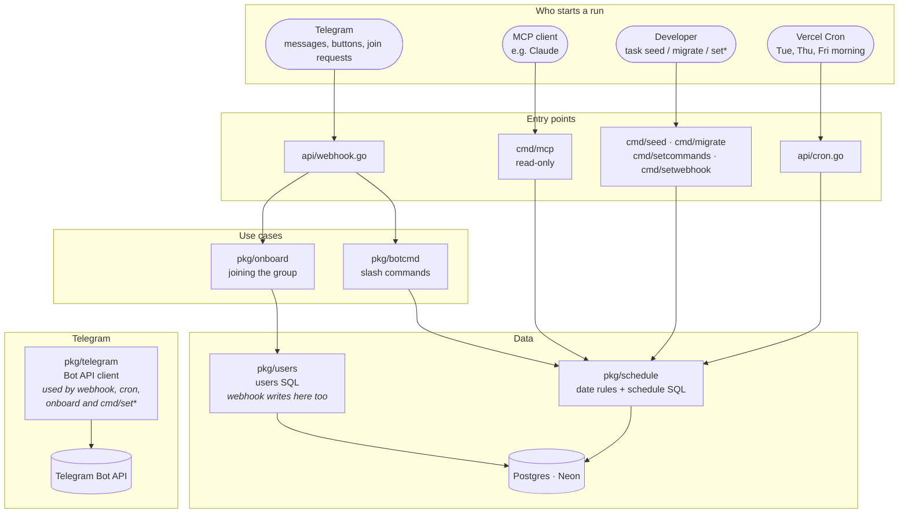

# Architecture: who calls what

Every arrow means "calls" or "reads/writes". Read it top to bottom: something
outside starts a run, an entry point handles it, and the run ends in the
database or the Telegram Bot API.

Two edges are written into the boxes instead of drawn, because as arrows they
cross half the picture:

- `pkg/telegram` is called by `api/webhook.go`, `api/cron.go`, `pkg/onboard`
  and `cmd/setcommands` / `cmd/setwebhook`. It is the only code that talks to
  the Bot API.
- `api/webhook.go` writes to `pkg/users` directly: `recordUser` notes whoever
  runs a duty command.

What the picture doesn't show:

- `pkg/config` (read once by every entry point) and `pkg/db` (`db.Connect`).
- Each file in `api/` is its own Vercel function: they share code only through
  `pkg/`.
- Only `pkg/schedule/repo.go` and `pkg/users` hold SQL.
