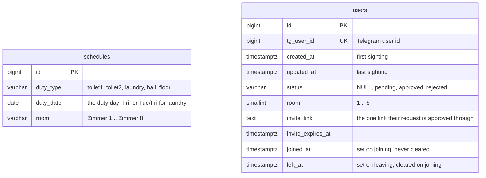

# Database

Two tables, applied by `cmd/migrate` from `migrations/*.sql`. There is no
foreign key between them: a schedule row names a room (`Zimmer 3`), a user row
holds a room number (`3`), and `schedule.RoomNo` / `schedule.ParseRoomNo`
convert between the two.

- `schedules` is unique on `(duty_type, duty_date)`: one room per duty and day.
- `users` is unique on `tg_user_id`. No names are stored.
- `users.status` is the onboarding's state; `rejected` is the block list.
- `users.room` is limited to 1..8 by `users_room_check`, which mirrors
  `schedule.RoomCount` by hand.
- `joined_at` or `left_at` set marks a former member.
