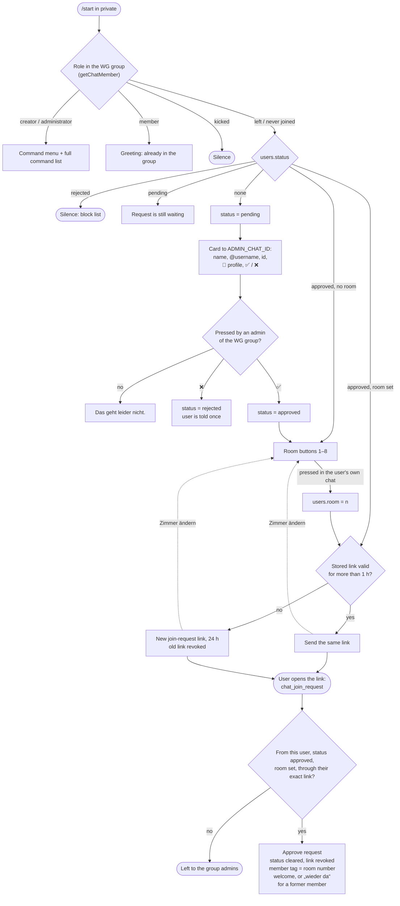

# Onboarding flow

What happens after somebody sends `/start` to the bot in private. The steps
are described in the README's [Onboarding](../README.md#onboarding) section;
this is the same flow with every branch.

Dashed arrows are the „Zimmer ändern“ button under the link: the room buttons
again, for an approved user who hasn't joined yet.
